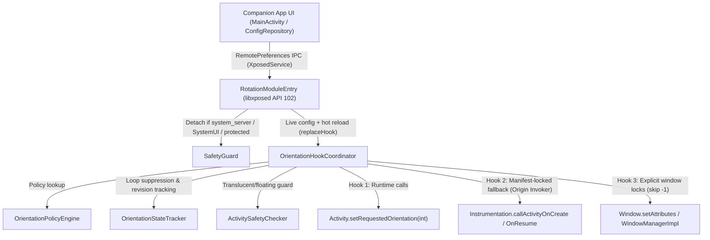

# Universal Force Rotation

[-3DDC84?logo=android&logoColor=white)](https://developer.android.com)
[](https://github.com/libxposed/api)
[](https://github.com/JingMatrix/Vector)
[](https://kotlinlang.org)
[](https://github.com/Sagormodak/UniversalForceRotation/releases/tag/v1.0.0)
[](LICENSE)

A modern **Xposed module** written in Kotlin for **Android 17**, **Vector 2.2**, and **Modern libxposed API 102** (`io.github.libxposed:api:102.0.0` + `io.github.libxposed:service:102.0.0`) that lets portrait-locked and landscape-locked apps follow your device's Auto Rotate preference or per-app orientation overrides.

Download prebuilt APKs from **[GitHub Releases (`v1.0.0`)](https://github.com/Sagormodak/UniversalForceRotation/releases/tag/v1.0.0)** or the [`releases/`](releases/) directory.

---

## Target Environment & Why Modern libxposed API 102

Legacy `de.robv.android.xposed.*` modules fail in modern-only Vector configurations with `Cannot support "VectorLegacy" Hook Framework`. Universal Force Rotation uses **strictly Modern libxposed API 102** (`compileOnly("io.github.libxposed:api:102.0.0")`) and `XposedProvider` (`implementation("io.github.libxposed:service:102.0.0")`), with zero legacy Xposed dependencies and zero APK or system-partition patching.

| Component | Target Specification |
| :--- | :--- |
| **Device** | Samsung Galaxy A52s 5G (`a52sxq`) |
| **ROM / OS** | Infinity X — Android 17 (API 37) |
| **Root** | Magisk with Zygisk enabled |
| **Framework** | Vector 2.2 (3119) |
| **Module API** | Modern libxposed API `102.0.0` (`minApiVersion=101`, `targetApiVersion=102`, `autoHotReload=true`, `staticScope=false`) |

---

## Orientation Override Engine Architecture



### Multi-Layer Interception Details

1. **Runtime Requests (`Activity.setRequestedOrientation(int)`)**
   - Intercepts programmatic orientation locks across `onCreate`, `onResume`, click handlers, media players, and third-party libraries.
   - Replaces requests with the resolved policy orientation (default: `SCREEN_ORIENTATION_FULL_USER = 13`).
   - `OrientationStateTracker` suppresses duplicate identical calls on the same `Activity` and policy revision, preventing orientation churn, Binder IPC spam, and Android 16/17 `ActivityRecord` loop throttling (`> 2 requests/sec`).
2. **Manifest-Declared Fallback (`Instrumentation.callActivityOnCreate` & `callActivityOnResume`)**
   - Runs after `chain.proceed()` so apps locking orientation solely via `<activity android:screenOrientation="..." />` (without ever calling `setRequestedOrientation()`) are overridden via `Invoker.Type.ORIGIN` without recursion.
   - Restores original orientation on `onResume` when an app is excluded or Master Enable is toggled off live.
3. **Window Attributes & Layout Hooks (`Window.setAttributes` & optional `WindowManagerImpl.addView/updateViewLayout`)**
   - Rewrites explicit `WindowManager.LayoutParams.screenOrientation` locks while keeping `SCREEN_ORIENTATION_UNSPECIFIED (-1)` intact so popups/menus/toasts do not impose artificial locks.
4. **Safety, Android 17 Policy & API 102 Hot Reload**
   - **`SafetyGuard`:** Never hooks `system_server`, `com.android.systemui`, `com.android.phone`, `com.android.bluetooth`, `com.android.permissioncontroller`, Vector Manager, or itself, calling `detach()` immediately if scoped.
   - **`ActivitySafetyChecker`:** Guards translucent/floating activities against `IllegalStateException` (`Only fullscreen opaque activities can request orientation`) on fixed modes and catches any framework rejection safely.
   - **Android 16/17 Large-Screen Policy:** Android 16/17 ignores fixed orientation requests on displays with `smallestScreenWidthDp >= 600dp`. Because the Galaxy A52s 5G is a smartphone (`sw < 600dp`), apps still enforce portrait/landscape locks normally — handled by this module inside each scoped process.
   - **API 102 Hot Reload:** Uses `HookBuilder.setId(...)`, cleanly releases preference listeners in `onHotReloading`, and atomically swaps hooks via `HookHandle.replaceHook(...)` in `onHotReloaded`.

---

## Supported Orientation Modes

| Mode | Android Constant | Value | Behavior |
| :--- | :--- | :---: | :--- |
| **Follow System Auto Rotate** *(Default)* | `SCREEN_ORIENTATION_FULL_USER` | `13` | Allows all 4 orientations when Auto Rotate is ON; respects rotation lock when OFF |
| **Force Portrait** | `SCREEN_ORIENTATION_PORTRAIT` | `1` | Forces standard portrait |
| **Force Landscape** | `SCREEN_ORIENTATION_LANDSCAPE` | `0` | Forces standard landscape |
| **Reverse Portrait** | `SCREEN_ORIENTATION_REVERSE_PORTRAIT` | `9` | Forces upside-down portrait |
| **Reverse Landscape** | `SCREEN_ORIENTATION_REVERSE_LANDSCAPE` | `8` | Forces reverse landscape |
| **Full Sensor** | `SCREEN_ORIENTATION_FULL_SENSOR` | `10` | Rotates across all 4 orientations ignoring Auto Rotate lock |

---

## Companion Configuration App UI

- **Material 3 + Dynamic Color (Light & Dark):** Status banner showing live Vector version, libxposed API version, scope count, and active hooked targets.
- **Global Controls:** Master Enable/Disable switch, Global Force Rotation switch, and Default Orientation Mode picker.
- **App List & Search:** Real-time search by label/package, filter chips (`Third-Party`, `Excluded`, `Custom Mode`, `In Vector Scope`, `System`, `All`), per-app enable switch, and bottom sheet for custom per-app modes and single-app Vector scope requests.
- **Exclusions & Policy Tab:** System app default exclusion toggle (ON by default), verbose hook logging toggle, one-tap override reset, and read-only view of protected critical system packages.
- **Diagnostics Tab:** Device/Android 17 `smallestWidthDp` policy telemetry, live Auto Rotate & display rotation readout, API 102 running hooked targets + manual Hot Reload triggers, and clipboard diagnostics export.

---

## Project Structure

```text
UniversalForceRotation/
├── app/                          # Xposed module + Material 3 companion UI (com.sagor.universalforcerotation)
│   ├── build.gradle.kts
│   ├── proguard-rules.pro
│   └── src/
│       ├── main/
│       │   ├── AndroidManifest.xml
│       │   ├── java/com/sagor/universalforcerotation/
│       │   │   ├── UniversalForceRotationApp.kt
│       │   │   ├── model/        (OrientationMode, RotationConfig, AppEntry)
│       │   │   ├── core/         (SafetyGuard, OrientationPolicyEngine, OrientationStateTracker, ConfigSerializer, HookLogger)
│       │   │   ├── data/         (ConfigRepository, InstalledAppsRepository, XposedServiceManager)
│       │   │   ├── xposed/       (RotationModuleEntry, OrientationHookCoordinator, ActivitySafetyChecker)
│       │   │   └── ui/           (MainActivity, AppsFragment, AppListAdapter, AppConfigBottomSheet, ExclusionsFragment, DiagnosticsFragment, AppIconCache)
│       │   ├── res/
│       │   └── resources/META-INF/xposed/
│       │       ├── java_init.list
│       │       └── module.prop
│       └── test/java/com/sagor/universalforcerotation/
├── testapp/                      # Rotation Test Lab companion test harness (com.sagor.universalforcerotation.testapp)
├── gradle/
│   ├── libs.versions.toml
│   └── wrapper/
├── releases/                     # Prebuilt verified APKs + SHA256SUMS.txt
├── INSTALLATION.md
├── TESTING.md
├── TROUBLESHOOTING.md
├── LICENSE
├── build.gradle.kts
└── settings.gradle.kts
```

---

## Building from Source

Requirements: **JDK 21** and **Android SDK Platform 37 (Android 17)**.

```bash
./gradlew clean
./gradlew :app:testDebugUnitTest
./gradlew :app:assembleDebug :app:assembleRelease :testapp:assembleDebug
```

> **Release Signing Note:** `app/build.gradle.kts` reads `keystore.properties` (or `UFR_KEYSTORE_*` environment variables) for a custom release signing key and falls back to the Android debug key when absent (matching `libxposed/example`). Provide your own keystore before public redistribution.

---

## Prebuilt Release Artifacts & Checksums

| Artifact | Size (bytes) | SHA-256 |
| :--- | :---: | :--- |
| `UniversalForceRotation-v1.0.0-release.apk` | `1,851,924` | `7b9002c59da0d9f96f69151c23ce4e1e11d279a1d23854efb6b574b328030bdc` |
| `UniversalForceRotation-v1.0.0-debug.apk` | `7,322,712` | `ef826ba5ead217429a6dbad84254a0735fa8d99bd005a1ff89772df28097c825` |
| `UniversalForceRotation-TestLab-v1.0.0-debug.apk` | `6,842,984` | `07bf2f36cad5b1a88e552558d51985d840ea8e3e7f018901c756f89b01cfb735` |

---

## Verification Summary

- **Build Verification:** **Passed** (`clean :app:testDebugUnitTest :app:assembleDebug :app:assembleRelease :testapp:assembleDebug` -> `BUILD SUCCESSFUL`, 0 compiler warnings; `aapt2`, `apksigner`, and `dexdump` verified `RotationModuleEntry` + `XposedProvider` present and `io.github.libxposed.api.XposedModule` absent from DEX in both Debug and R8 Release builds).
- **Unit Testing:** **Passed (23 / 23)** across 5 JVM suites (`ConfigSerializerTest`, `HookCoordinatorSimulationTest`, `OrientationPolicyEngineTest`, `OrientationStateTrackerTest`, `SafetyGuardTest`).
- **Emulator Testing:** Not executed (no emulator/AVD installed in build environment).
- **Real-Device Testing:** Pending on **Samsung Galaxy A52s 5G** — see [TESTING.md](TESTING.md) for the 10-scenario verification matrix with `Rotation Test Lab`.

---

## Documentation

- [Installation & Usage Guide](INSTALLATION.md)
- [Testing Plan & Verification Report](TESTING.md)
- [Troubleshooting Guide](TROUBLESHOOTING.md)
